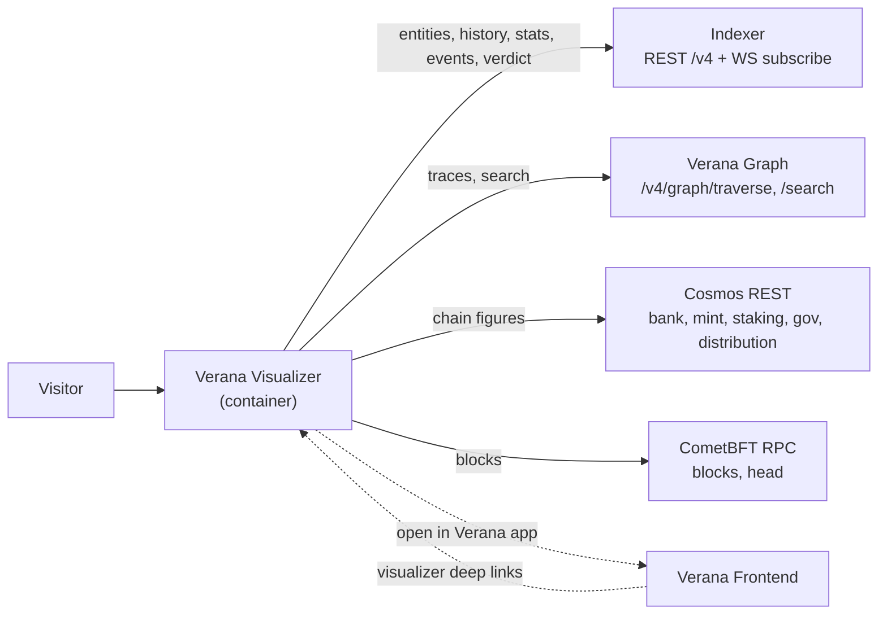

# Verana Visualizer v4 Specification

**Latest Draft:** spec v4-draft1

## Abstract

The **Verana Visualizer** is the public, read-only, wallet-less observatory of a Verana v4 network. It renders the registry as a navigable 3D scene (Ecosystems, Participants, Verifiable Services and the chain itself), answers the question "can I trust this service?" with a citable verdict, and gives operators a view of network health.

This document specifies the normative behavior of the Visualizer: its boundaries with the other Verana components, its container configuration, its data sources, its seven lenses, its routes, permalinks and legacy redirects, the deep-link contract used by the [Verana Frontend](../verana-frontend/spec.md), and the honesty rules that every figure and animation MUST satisfy.

## About this Document

In order to fully understand the concepts developed in this document, you should have some basic knowledge of the [Verifiable Trust Specification v4](https://verana-labs.github.io/verifiable-trust-spec/versions/v4/), the [Verifiable Trust VPR Specification v4](https://verana-labs.github.io/verifiable-trust-vpr-spec/versions/v4/), the [Indexer v4 Specification](../verana-indexer/spec.md) and the [Verana Graph Specification](../verana-graph/spec.md). All terms used in this specification are defined in the [Terminology](#terminology) section or inherited from those documents.

## Conformance

As well as sections marked as non-normative, all authoring guidelines, diagrams, examples, and notes in this specification are non-normative. Everything else in this specification is normative.

The key words MAY, MUST, MUST NOT, OPTIONAL, RECOMMENDED, REQUIRED, SHOULD, and SHOULD NOT in this document are to be interpreted as described in [BCP 14](https://datatracker.ietf.org/doc/html/bcp14) [RFC2119](https://w3c.github.io/vc-data-model/#bib-rfc2119) [RFC8174](https://w3c.github.io/vc-data-model/#bib-rfc8174) when, and only when, they appear in all capitals, as shown here.

## Terminology

Terms inherited from the VPR v4 specification keep their meaning there: **Corporation**, **Ecosystem**, **Credential Schema**, **Participant**, **Onboarding Process (OP)**, **Trust Deposit**, **Trust Unit (TU)**. Visualizer-specific terminology:

- **lens** — one of the seven presentations of the shared 3D scene ([VVZ-LENS]).
- **scene** — the persistent 3D rendering of the network. Switching lens re-arranges and re-colors the same entities; it never replaces them.
- **view state** — the lens, selection, time position, open panels, tour step and camera of the current view, encoded in the URL ([VVZ-ROUTE-1]).
- **verdict** — the overall result returned by the indexer's trust resolution ([`IDX-VT-QRY-1`](../verana-indexer/spec.md#idx-vt-qry-1-resolve)) for a DID.
- **hop** — one Participant on the validator chain between a Verifiable Service's credential issuer and the Ecosystem root. A hop carries informational state only ([VVZ-HONEST-3]).
- **legacy name** — an environment variable name or route used by the pre-v4 Visualizer and still accepted ([VVZ-ENV-3], [VVZ-ROUTE-5]).

## Architecture Overview

*This section is non-normative.*

The Visualizer is a containerized web application serving a single network per deployment (for example `vis.devnet.verana.network`, `vis.testnet.verana.network`). It performs reads only and holds no key, wallet or secret.

Boundaries:

- The **Frontend** owns list and detail management screens and every write. The **Graph** owns traversal queries. The **Indexer** owns history, aggregates and trust resolution. The Visualizer owns *seeing and understanding the network* and links out to the others.
- The Visualizer MUST NOT implement any write action, connect a wallet or hold a signing key.

## [VVZ-GEN] General

### [VVZ-GEN-DEPLOY] Deployment

- [VVZ-GEN-DEPLOY-1] The Visualizer MUST be delivered as a container image, versioned and published to a public registry (Docker Hub), together with a Helm chart.
- [VVZ-GEN-DEPLOY-2] All configuration MUST be injectable at container start (runtime environment), so that one image serves any network without rebuild. Asset and base paths MUST NOT depend on build-time environment.
- [VVZ-GEN-DEPLOY-3] No secret MUST reach the browser. The Visualizer MUST NOT require any API token.

### [VVZ-GEN-SCOPE] Scope

- [VVZ-GEN-SCOPE-1] Each deployment MUST talk only to the network it is configured for. Switching network is a link to the peer deployment ([VVZ-ENV-4]), never a client-side re-pointing of endpoints.
- [VVZ-GEN-SCOPE-2] The scene MUST remain reachable without WebGL: when WebGL is unavailable the Visualizer MUST present a 2D list of the same entities rather than a blank page.
- [VVZ-GEN-SCOPE-3] Every entity shown in the scene MUST also be reachable through search and the inspector, which MUST be keyboard accessible. When `prefers-reduced-motion` is set, auto-rotation MUST be disabled and transitions shortened.

## [VVZ-ENV] Environment Contract

### [VVZ-ENV-1] Container Environment Variables

| Variable | Required | Description |
|---|---|---|
| `NEXT_PUBLIC_VERANA_INDEXER_BASE_URL` | REQUIRED unless resolvable via a legacy name | Indexer base URL (e.g. `https://idx.testnet.verana.network`). All indexer REST paths are `{base}/v4/...` per the [Indexer v4 Specification](../verana-indexer/spec.md); the WebSocket endpoint is `wss://{host}/v4/indexer/subscribe`. |
| `NEXT_PUBLIC_VERANA_RPC_ENDPOINT` | REQUIRED unless resolvable via a legacy name | CometBFT RPC endpoint. |
| `NEXT_PUBLIC_VERANA_REST_ENDPOINT` | REQUIRED unless resolvable via a legacy name | Cosmos REST (LCD) endpoint. |
| `NEXT_PUBLIC_VERANA_GRAPH_URL` | OPTIONAL | Verana Graph base URL. Derived from the indexer host when unset ([VVZ-ENV-3]). |
| `NEXT_PUBLIC_VERANA_FRONTEND_URL` | OPTIONAL | Verana Frontend base URL, target of "open in Verana app" links. Derived when unset. |
| `NEXT_PUBLIC_VERANA_CHAIN_ID` | OPTIONAL | Chain id (e.g. `vna-testnet-1`). |
| `NEXT_PUBLIC_VERANA_CHAIN_NAME` | OPTIONAL | Human-readable network name shown in the UI (e.g. `testnet`). |
| `NEXT_PUBLIC_VERANA_PEER_VISUALIZER_URL` | OPTIONAL | Base URL of the other network's Visualizer, target of the network switch. Derived when unset. |

- [VVZ-ENV-2] Variable names follow those of the [Verana Frontend](../verana-frontend/spec.md#vfe-gen-env-container-environment-variables) wherever the Frontend defines one (`…_INDEXER_BASE_URL`, `…_RPC_ENDPOINT`, `…_CHAIN_ID`, `…_CHAIN_NAME`).
- [VVZ-ENV-3] **Legacy fallbacks.** The Visualizer MUST read the pre-v4 names as fallbacks, so existing deployments keep working: `NEXT_PUBLIC_IDX_ENDPOINT` (indexer), `NEXT_PUBLIC_RPC_ENDPOINT` (RPC), `NEXT_PUBLIC_API_ENDPOINT` (REST), `NEXT_PUBLIC_CHAIN_ID`, `NEXT_PUBLIC_CHAIN_NAME`. A v4 name MUST take precedence over its legacy name. When the graph, frontend or peer URL is unset, the Visualizer MUST derive it from the indexer host following the `idx.<net>.verana.network` convention: `graph.<net>.verana.network`, `app.<net>.verana.network`, and `vis.<other-net>.verana.network`.
- [VVZ-ENV-4] The peer URL is used only by the network switch, which MUST carry the current view state ([VVZ-ROUTE-1]) to the peer deployment.
- [VVZ-ENV-5] At start, the container MUST fail fast, naming the missing variable, when the indexer, RPC or REST endpoint can be resolved neither directly nor from a legacy name.
- [VVZ-ENV-6] The Visualizer MUST NOT read a resolver endpoint; the standalone resolver is not part of v4.

## [VVZ-DATA] Data Sources

- [VVZ-DATA-1] The Indexer `/v4/*` API MUST be the default source for every entity, history, statistic and event. Real-time events MUST come from [`IDX-INDEXER-SUB-1`](../verana-indexer/spec.md#idx-indexer-sub-1-subscribe-indexer-events).
- [VVZ-DATA-2] Validator-chain traces MUST use the Graph traversal query **G1** ([`TG-QRY-3`](../verana-graph/spec.md#graph-traversal-queries) via the binding of [`TG-QRY-5`](../verana-graph/spec.md#traversal-rest-binding)); search MUST use the Graph faceted-search binding ([`TG-FCT-9`](../verana-graph/spec.md#search-rest-binding)).
- [VVZ-DATA-3] Bank, mint, staking, distribution and governance figures MUST come from Cosmos REST; blocks and the chain head from CometBFT RPC.
- [VVZ-DATA-4] A failed request MUST surface as an explicit error state. The Visualizer MUST NOT substitute demo, cached-as-fresh or generated data.
- [VVZ-DATA-5] **Show the query.** Every inspector panel and lens MUST be able to display the exact Indexer, Graph or chain request behind its figures, with a copy-as-curl action.

| Use | Requirements |
|---|---|
| Ecosystems, schemas, corporations | `IDX-ES-QRY-1/2/3/4`, `IDX-CS-QRY-1/2/4/5`, `IDX-CO-QRY-1/2/3/4` |
| Participants and lifecycle | `IDX-PP-QRY-1/2/3/5/8` |
| Trust deposits and fee economics | `IDX-TD-QRY-1/2/3`, `IDX-PP-QRY-4`, `IDX-ES-QRY-3`, `IDX-CS-QRY-4` |
| TU exchange rate | `IDX-XR-QRY-1/2/3` |
| Corporation groups, proposals and votes | `IDX-GR-QRY-1/2/3/4/5` |
| Growth, history and time replay | `IDX-STATS-QRY-1/2/3/4`, `IDX-INDEXER-QRY-5` (`next_change_at`), `IDX-PP-QRY-3`, `IDX-ES-QRY-4` |
| Verifiable Services and verdicts | `IDX-VT-QRY-1`, `IDX-VT-QRY-3`, `IDX-VT-EVAL-1` to `IDX-VT-EVAL-5` |
| Live activity and health | `IDX-INDEXER-SUB-1`, `IDX-INDEXER-QRY-1/2/3/4/6` |
| Validator chain trace | `TG-QRY-3` (G1), `TG-QRY-5` |
| Search | `TG-FCT-1` to `TG-FCT-9` |

## [VVZ-LENS] The Seven Lenses

- [VVZ-LENS-1] The Visualizer MUST offer exactly seven lenses, in this order: **Network**, **Trust**, **Economics**, **Chain**, **Time**, **Governance**, **Registry**. It MUST NOT offer an eighth lens or a "more" menu. The lens identifiers in the `lens` query parameter ([VVZ-ROUTE-1]) are `network`, `trust`, `economics`, `chain`, `time`, `governance`, `registry`; `network` is the default.
- [VVZ-LENS-2] All lenses MUST re-arrange or re-color the same persistent scene, so an entity keeps its identity across lens changes.
- [VVZ-LENS-3] Every lens MUST have a meaningful, non-empty state when the network is quiet, built from persisted state rather than recent activity.

| Lens | Shows | Main data |
|---|---|---|
| **Network** | Ecosystems as stars, Participants on orbits (one orbit per Credential Schema, radius by accreditation tier), Verifiable Services near the accreditations they hold. | `IDX-ES-QRY-2`, `IDX-CS-QRY-2`, `IDX-PP-QRY-2`, `IDX-CO-QRY-2`, `IDX-VT-QRY-3` |
| **Trust** | Accreditation trees per Ecosystem: root → grantors → issuers and verifiers → holders, following `validator_participant_id`. Hosts the trust check ([VVZ-TRUST]). | `IDX-PP-QRY-2`, `TG-QRY-3` (G1), `IDX-VT-QRY-1` |
| **Economics** | Trust deposits, fee rules per schema and Participant, cumulative fees, yield and slashes, and the what-if simulator ([VVZ-ECON]). | `IDX-TD-QRY-1/2/3`, `IDX-STATS-QRY-1/2`, `IDX-XR-QRY-1/2/3` |
| **Chain** | Consensus and liveness: validators sized by voting power around the chain core, and the stream of recent blocks with transaction counts. | Cosmos REST staking, CometBFT RPC, `IDX-INDEXER-SUB-1` |
| **Time** | Replay of the network from genesis or any block: entities appear when created and states change as they did, with a scrubber, an event-density strip and jump to the next event. | `IDX-STATS-QRY-2`, `IDX-INDEXER-QRY-5`, `*-History` queries, `At-Block-Height` |
| **Governance** | Each Corporation as a constellation of its group members with weights, open and past proposals and votes; chain-level governance and software-upgrade proposals. | `IDX-GR-QRY-1/3/4/5`, Cosmos `gov/v1` |
| **Registry** | Lifecycle and coverage: onboarding states, effective windows and upcoming expirations, and Ecosystem × schema × service coverage. | `IDX-PP-QRY-2/5`, `IDX-CS-QRY-2` |

### [VVZ-LENS-SHELL] Shell

- [VVZ-LENS-SHELL-1] The shell MUST provide: a headline strip (network, live block height, ecosystems, participants, credentials issued, trusted services out of total); a lens bar; a command-palette search over Ecosystems, Participants, services (DIDs), Corporations and Credential Schemas; an inspector showing one entity at a time with an "open in Verana app" link to `NEXT_PUBLIC_VERANA_FRONTEND_URL`; a live activity feed; a legend; and a footer linking to the documentation, the Verana app, the Graph and the Indexer API.
- [VVZ-LENS-SHELL-2] The network switch MUST visually distinguish networks with a per-network accent so that screenshots cannot be confused.
- [VVZ-LENS-SHELL-3] The shell MUST provide a health strip reporting the status of the Indexer, the Graph and the chain, and the Indexer's lag behind the chain head. Lag is a health metric and MUST NOT be phrased as a statement about network activity ([VVZ-HONEST-2]).

## [VVZ-TRUST] Trust Check and Verdict Card

- [VVZ-TRUST-1] Given a DID, the Visualizer MUST obtain the trust verdict from [`IDX-VT-QRY-1`](../verana-indexer/spec.md#idx-vt-qry-1-resolve) (`POST /v4/verifiable-trust/resolve`). That verdict is the only authoritative result.
- [VVZ-TRUST-2] The Visualizer MUST present the chain DID → credentials → issuer Participant → validator chain → Ecosystem root, with the validator chain obtained from G1 ([VVZ-DATA-2]).
- [VVZ-TRUST-3] The verdict MUST be readable with motion disabled.
- [VVZ-TRUST-4] The route `/verdict/{did}` ([VVZ-ROUTE-3]) MUST render the check as a static, printable receipt containing: the DID, the credential(s), the issuer, the validators, the root, the verdict, the block height, the evaluation time and the raw JSON response.
- [VVZ-TRUST-5] The chain MUST also be available as a copyable list of identifiers together with the raw JSON.
- [VVZ-TRUST-6] An ECS-compliance badge MAY be shown on an Ecosystem only when it can be computed from the data per the Verifiable Trust specification. A badge reading "unknown" MUST NOT be shown.

## [VVZ-ECON] Economics Simulator

- [VVZ-ECON-1] The Economics lens MUST include a what-if simulator taking onboarding, issuance and verification fees, Participants per role, and monthly issuance and verification volume, and producing validator revenue, trust-deposit growth and the payer's total cost.
- [VVZ-ECON-2] The simulator MUST apply the VPR business-model rules with the current on-chain trust-deposit parameters ([`IDX-TD-QRY-2`](../verana-indexer/spec.md#idx-td-qry-2-get-trust-deposit-params)).
- [VVZ-ECON-3] The simulator MUST be labelled as a simulation and be visually separate from live data. It is the only simulated content permitted ([VVZ-HONEST-1]).
- [VVZ-ECON-4] Amounts MUST be computed and shown in TU. A VNA equivalent MUST be shown only when a live exchange rate exists ([`IDX-XR-QRY-1`](../verana-indexer/spec.md#idx-xr-qry-1-get-exchange-rate)); an assumed rate MUST NOT be used, and the rate statistic MUST be hidden while no rate is published.

## [VVZ-ROUTE] Routes, Permalinks and Redirects

- [VVZ-ROUTE-1] The route `/` renders the scene. All view state MUST be carried in query parameters, so that opening a copied URL restores the view: `lens` ([VVZ-LENS-1]), `sel` (selected entity as `<kind>:<id>`), `t` (Time position), `panel` (open panels), `tour` (tour step) and `cam` (camera). `q` carries a search query.

- [VVZ-ROUTE-2] The route `/e/{kind}/{id}` MUST open the scene focused on the entity, where `kind` is one of `ecosystem`, `schema`, `participant`, `corporation`, `did`. The `id` of a `did` entity is the percent-encoded DID.

- [VVZ-ROUTE-3] The route `/verdict/{did}` renders the verdict card ([VVZ-TRUST-4]); the optional `block` query parameter evaluates the verdict at that block height.
- [VVZ-ROUTE-4] The route `/health` renders a sanity view that checks every data source the Visualizer uses against the configured network and shows pass or fail for each. `/health?format=json` MUST return the same result as JSON for deploy verification.

- [VVZ-ROUTE-5] The Visualizer MUST keep the following pre-v4 routes working through redirects, because the Frontend deep-links into them:

| Legacy route | Redirects to |
|---|---|
| `/did-directory?did=<did>` | `/?sel=agent:<did>` |
| `/did-directory?controller=<value>` | `/?q=<value>` |
| `/permissions?permission=<N>` | `/?sel=participant:<N>` |
| `/dashboard` | `/?lens=chain` |
| `/trust-registries` | `/?lens=network` |
| `/network-graph` | `/` |
| `/governance` | `/?lens=governance` |
| `/governance/<N>` | `/?lens=governance&sel=proposal:<N>` |
| `/ecosystem` | `/?lens=registry` |

## [VVZ-LINK] Deep-Link Contract with the Frontend

- [VVZ-LINK-1] The Frontend's `NEXT_PUBLIC_VERANA_VISUALIZER_URL` ([VFE-GEN-ENV](../verana-frontend/spec.md#vfe-gen-env-container-environment-variables)) is the base URL of a Visualizer deployment for the same network.
- [VVZ-LINK-2] The "visualizer links" of the Participant detail card ([VFE-PAGE-PT-3](../verana-frontend/spec.md#vfe-page-pt-participants)) and other Frontend entity links MUST resolve against this base using either the permalinks of [VVZ-ROUTE-2] or the legacy routes of [VVZ-ROUTE-5], both of which MUST remain supported.
- [VVZ-LINK-3] An unknown or removed entity in a permalink MUST render an explicit not-found state in the scene shell, never an empty scene.

## [VVZ-HONEST] Honesty Rules

- [VVZ-HONEST-1] **Real events only.** Every animation MUST correspond to a real, timestamped event from the Indexer or the chain. Nothing MUST be generated to fill a quiet network. The only simulated content is the simulator of [VVZ-ECON-3], and purely decorative background elements MUST NOT be presented as data.
- [VVZ-HONEST-2] The Visualizer MUST NOT present a "last transaction N ago" indicator or any equivalent statement that the network is quiet.
- [VVZ-HONEST-3] **The Indexer verdict is authoritative.** The Visualizer MUST NOT re-implement trust evaluation. Each hop of a trace MUST be labelled as state (Participant state and onboarding state from the Indexer and G1), never as a verdict of its own.
- [VVZ-HONEST-4] **TU without a rate.** While no TU exchange rate is published, all amounts MUST be shown in TU only ([VVZ-ECON-4]).
- [VVZ-HONEST-5] Exported images (PNG) MUST be stamped with network, block height, timestamp and source.
- [VVZ-HONEST-6] "What changed" digests MUST be computed from stats buckets and history, and MUST only report changes that occurred.

## References

- [Verifiable Trust Specification v4](https://verana-labs.github.io/verifiable-trust-spec/versions/v4/)
- [Verifiable Trust VPR Specification v4](https://verana-labs.github.io/verifiable-trust-vpr-spec/versions/v4/)
- [Indexer v4 Specification](../verana-indexer/spec.md)
- [Verana Graph Specification](../verana-graph/spec.md)
- [Verana Frontend v4 Specification](../verana-frontend/spec.md)
