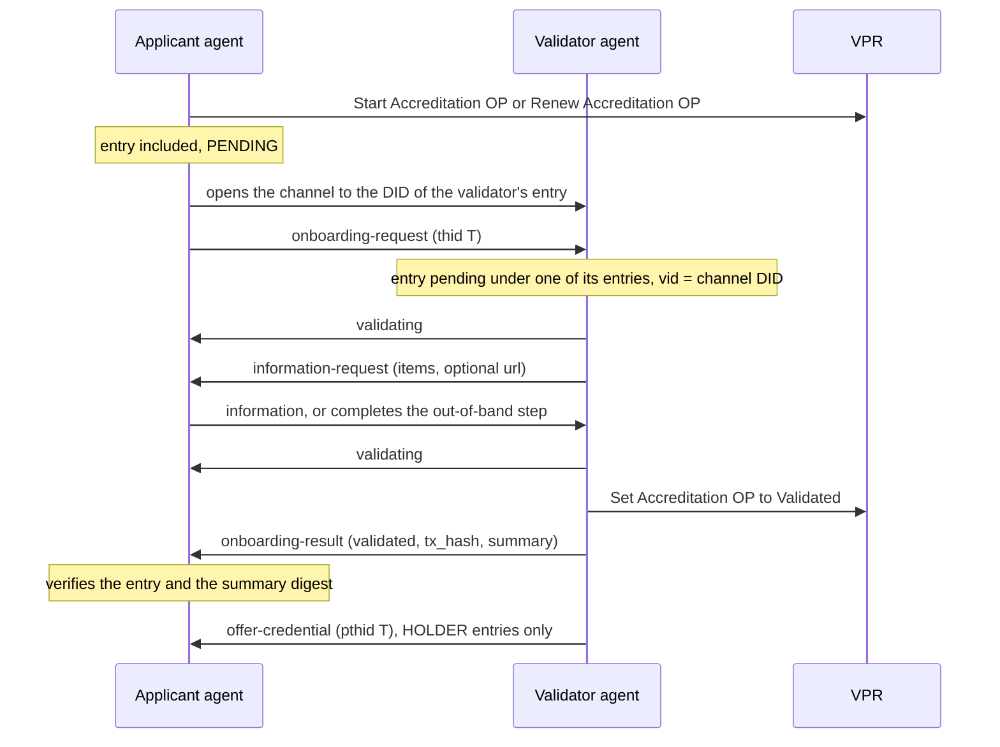
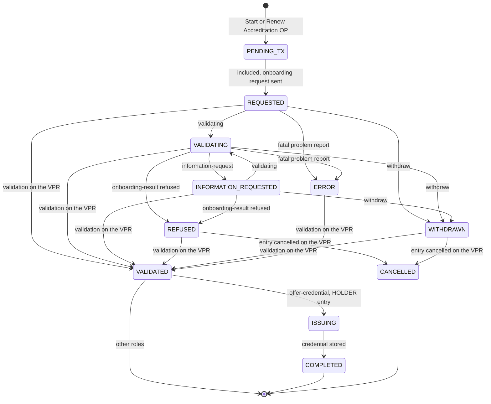

# Verifiable Trust Flow Protocol 5.0 (vt-flow)

- **Status:** DRAFT
- **Implements:** the Verifiable Trust Protocol ([VT-PROTO][vt-proto]) of the [Verifiable Trust Specification v5][vt-spec], over its [DIDComm v2 binding][bind-v2].
- **Protocol identifier:** `https://didcomm.org/vt-protocol/5.0`, as the binding defines it.
- **Envelope:** DIDComm v2 only.
- **Supersedes:** [vt-flow 1.0](../../v4/vt-flow-protocol/spec.md) (v4).

## Summary

The Verifiable Trust Specification v5 defines, abstractly, every exchange that two parties run over a trusted channel: peer verification, the onboarding process of an `Accreditation` entry, credential issuance, credential presentation, notifications and resumption ([VT-PROTO][vt-proto]). Its DIDComm v2 binding maps those messages onto DIDComm v2: message types, `body` fields, threads and the DIDComm protocols that carry offers, credentials and presentations ([bind-v2]).

`vt-flow` 5.0 is the Verana profile of that protocol. It is what the VS Agent implements, and what a Verana VUA implements for the flows it takes part in. It adds to the specification and the binding only what they leave to implementations: which flows an agent runs and in which roles, the state each party keeps, how threads are laid out where the binding leaves a choice, how errors are encoded, how exchanges are persisted and resumed. It defines no message, field or error code of its own: the VT spec and the binding prevail, and a choice this document makes where they are silent is marked **profile choice**.

Compared with vt-flow 1.0, the protocol is no longer a Verana-specific DIDComm protocol: its messages are those of the VT spec, carried as the binding says, and it covers presentation and notifications in addition to onboarding and issuance. See [Changes from vt-flow 1.0](#changes-from-vt-flow-10).

## Conformance

- [VFLOW-1] **DIDComm v2 only.** A vt-flow agent implements the [DIDComm v2 binding][bind-v2] and declares a `DIDCommMessaging` service in the DID Document of each service it runs ([VT-BIND-DIDCOMM2-1]). It does not implement the DIDComm v1 binding. The VT spec requires DIDComm v2 and recommends every listed protocol ([VS-SVC-2], [VUA-REQ-4]); a vt-flow agent meets the requirement and departs from the recommendation, so that a peer that speaks DIDComm v1 only cannot open a channel with it.
- [VFLOW-2] **Precedence.** The VT spec and the binding prevail over this document. Every rule of [VT-PROTO][vt-proto] applies to a vt-flow agent whether or not this document repeats it; the rules below say how the agent meets them.
- [VFLOW-3] **Unknown content.** An agent ignores a `body` member it does not know ([VT-PROTO-1]). A message whose type it does not know, or that is not expected in the state of its exchange, is answered with a problem report `e.p.vt.out-of-order`, or `e.p.vt.malformed` when it cannot be parsed ([Errors](#errors)).

## References

| Reference | Used for |
| --- | --- |
| [VT spec v5][vt-spec]: [VT-PROTO][vt-proto], [VT-CHAN][vt-chan], [VT-PRES-VS][vt-pres], [VT-DECL][vt-decl], [CIT][vt-cit], [PRT][vt-prt], [TR][vt-tr] | The messages, their fields and order, and the checks each party makes |
| [DIDComm v2 binding][bind-v2] | Message types, `body` encoding, threads, Issue Credential 3.0, Present Proof 3.0, problem reports |
| [VPR spec v5][vpr-spec] | The transactions the exchanges record: [Start Accreditation OP][vpr-ac-1], [Renew Accreditation OP][vpr-ac-2], [Set Accreditation OP to Validated][vpr-ac-3], [Cancel Accreditation OP Last Request][vpr-ac-6], [Record Credential Exchange][vpr-ac-10], and the events notifications report |
| [DIDComm Messaging v2.1][didcomm-v2] | Envelope, threads, problem reports |
| [Issue Credential 3.0][ic3], [Present Proof 3.0][pp3] | The DIDComm protocols the binding maps offers, credentials and presentations onto |

## Terminology

The terms are those of the VT and VPR specifications. The table maps the vocabulary of vt-flow 1.0 to them.

| vt-flow 1.0 (v4) | vt-flow 5.0 |
| --- | --- |
| `Participant`, `participant_id` | `Accreditation` entry, `accreditation_id` |
| `StartParticipantOP`, `SetParticipantOPtoValidated` | [Start Accreditation OP][vpr-ac-1], [Set Accreditation OP to Validated][vpr-ac-3] |
| `ParticipantSession`, `participant_session_id`, `CreateOrUpdateParticipantSession` | `CredentialExchange` event, `exchange_id` (chosen by the holder), [Record Credential Exchange][vpr-ac-10] |
| `oob-link` | `information-request` with a `url` |
| `credential-state-change` | `credential-state` |
| Direct Issuance, `issuance-request` with `schema_id` | `issuance-request` with `vtjsc` ([VT-PROTO-ISS-1]) |
| `vt-flow.*` problem codes | the error codes of [VT-PROTO-4], encoded as in [Errors](#errors) |
| Applicant / Validator | the same, for the onboarding process; holder / issuer for issuance; verifier / holder for presentation |

An **exchange** is one run of a flow: an onboarding process, an issuance, or a presentation request with the presentations it leads to ([VT-PROTO-2]). A **peer** is the other party of a channel: a VS, identified by its DID and its [verifiable service entry][vpr-vs], or a VUA instance, identified by the keys it authenticated with.

## Channel and Peer Verification

- [VFLOW-CH-1] **Opening.** A party opens a channel to a VS from its DID, through the `DIDCommMessaging` service of its DID Document, or by accepting an out-of-band invitation whose `from` is that DID ([VT-BIND-DIDCOMM2-1]). Every message is authenticated-encrypted; the channel is bound to the DID of each VS party ([VT-CHAN-3]). A VUA uses a `did:peer` DID it controls.
- [VFLOW-CH-2] **Peer verification.** Before any other exchange, each party verifies the other as [VT-PROTO-VERIF][vt-verif] says: a VS by trust resolution of its DID, before opening the channel when it knows the DID, otherwise of the DID the channel authenticated; a VUA with the presentation flow for the User Agent schemas ([Credential Presentation](#credential-presentation)), automatic and with no `CredentialExchange`. Until both parties are verified the agent sends and acts on nothing else, except, under the exemptions of [VS-CONN-VS] and [VS-CONN-VUA], the onboarding process and the issuance of Organization, Persona, Service and User Agent credentials ([VT-PROTO-VERIF-3]). A failed verification ends the exchange with a problem report; a VUA closes the channel ([VUA-CONN-VUA]).
- [VFLOW-CH-3] **Caching.** An agent MAY reuse a trust resolution result while it is valid under [VS-REQ-7]: it re-verifies a peer on the events that rule lists (a trigger, a rotation, a change of the peer's entries, participations or corporation, a revoked digest, the end of a transition window, a status list change).
- [VFLOW-CH-4] **Current identifiers.** An agent starts an exchange with a VS, and acts on the first message of an exchange from a VS, only when the DID the channel authenticated is the current identifier of the VS's entry ([VT-PROTO-8]). After a rotation of a peer's identifier, it uses a channel under the former identifier only to complete the exchanges begun before the rotation and to send notifications, until the transition window ends ([VT-CHAN-5]); it opens a new channel to the current identifier for anything else.
- [VFLOW-CH-5] **Lifetime.** A channel stays open after an exchange completes, so that notifications can follow ([Notifications](#notifications-and-re-issuance)). An agent closes it when the peer fails a re-verification, and MAY close an idle channel; an exchange outlives its channel ([Resumption](#resumption)).

## Messages and Threads

Every message is a DIDComm v2 message whose `type` is the one the [binding's message types table][bind-v2-types] gives, whose `body` carries the fields of [VT-PROTO][vt-proto] under the same names, and whose `id` is a fresh UUID ([VT-BIND-DIDCOMM2-2], [VT-BIND-DIDCOMM2-5]). Example, the first message of an onboarding process:

```json
{
  "type": "https://didcomm.org/vt-protocol/5.0/onboarding-request",
  "id": "8a3f7c2b-9e4d-4b1a-8f6c-2e5a7d3b9c1f",
  "thid": "8a3f7c2b-9e4d-4b1a-8f6c-2e5a7d3b9c1f",
  "from": "did:web:applicant.example",
  "to": ["did:web:validator.example"],
  "created_time": 1793520000,
  "body": {
    "accreditation_id": "4211",
    "claims": { "name": "Example Org" }
  }
}
```

- [VFLOW-MSG-1] **Exchange thread.** The `thid` of every message of an exchange is the `id` of its first message: `onboarding-request`, `issuance-request`, `request` (presentation), or `offer-credential` when the issuer offers on its own initiative ([VT-BIND-DIDCOMM2-2]).
- [VFLOW-MSG-2] **Issue Credential and Present Proof threads.** *Profile choice.* Each Issue Credential 3.0 and each Present Proof 3.0 run has its own thread, whose `thid` is the `id` of its first message (`offer-credential`, `request-presentation`), and whose `pthid` is the `thid` of the exchange that led to it: the onboarding process for the offer that follows a validation ([VT-PROTO-OP-5]), the `issuance-request`, or the presentation `request` ([VT-BIND-DIDCOMM2-4]). An offer on the issuer's own initiative has no `pthid`; its run is the exchange.
- [VFLOW-MSG-3] **Messages that belong to one credential.** `exchange-recorded`, `presentation-digest` and the notifications that concern one issued credential carry its `exchange_id` in the `body`. *Profile choice:* `exchange-recorded` and `presentation-digest` are sent on the thread of the Issue Credential or Present Proof run of that credential when it has started, and on the exchange thread otherwise.
- [VFLOW-MSG-4] **Composite fields.** *Profile choice.* The `items` of `information-request` is an object `{ "description": <text>, "vtjscs": [<VTJSC>] }`, `vtjscs` optional; its `url` and the step's `expires` are two members, `url` and `expires` (RFC 3339); `proofs`, wherever it appears, is an array of DIDComm v2 attachment objects (`id`, `media_type`, `format`, `data`); timestamps are RFC 3339 strings; `tx_hash` is the uppercase hex transaction hash.

## Onboarding Process

The exchange of [VT-PROTO-OP][vt-op]: an applicant obtains from its validator the validation of an `Accreditation` entry it started on the VPR.



- [VFLOW-OP-1] **Request.** Once its Start Accreditation OP or Renew Accreditation OP transaction is included, the applicant opens a channel to the current identifier of the validator entry's service (`VerifiableService[validator_accreditation.vs_id].vid`) and sends `onboarding-request`. The validator answers `validating` after the checks of [VT-PROTO-OP-1], read through its indexer, or a problem report `e.p.vt.invalid-accreditation`. The binding of the channel to the applicant's current identifier is the proof of control of the entry; the agent asks for no other.
- [VFLOW-OP-2] **Information.** The validator sends `information-request` as many times as it needs ([VT-PROTO-OP-2]). A presentation it asks for runs as a [Credential Presentation](#credential-presentation) exchange whose `request` carries the onboarding thread as `pthid`. An out-of-band step is a `url` unique to the process; when it expires, the validator sends a new `information-request`, or refuses. The applicant answers `information`, or completes the step out of band; the validator answers `validating` after each answer or completed step.
- [VFLOW-OP-3] **Outcome.** The validator records Set Accreditation OP to Validated, waits for its inclusion, then sends `onboarding-result` `validated` with the `tx_hash`; or sends `onboarding-result` `refused`. The applicant MAY send `withdraw` at any time before the outcome. The VPR prevails ([VT-PROTO-OP-3]): each agent watches, through its indexer, the validation and the cancellation of the entry of every onboarding process it keeps, and moves the process to `VALIDATED` or `CANCELLED` on the event, whatever the messages said. After a refusal, the applicant agent MAY cancel the entry to recover its escrow ([Cancel Accreditation OP Last Request][vpr-ac-6]); a cancelled entry cannot be validated.
- [VFLOW-OP-4] **Summary.** When the validator records an `op_summary_digest`, it sends the summary in `onboarding-result`; the applicant verifies the digest against the entry, or, for a `PERMISSIONLESS` holder, against the `onboardingSummaryDigestSri` of the credential it then receives ([VT-PROTO-OP-4]). A mismatch is answered with a problem report `e.p.vt.malformed` and the applicant keeps the process in `VALIDATED` without the summary.
- [VFLOW-OP-5] **Holder entries.** For a `HOLDER` entry, the validator, which holds the `ISSUER` entry, sends `offer-credential` once the entry is validated, on a run whose `pthid` is the onboarding thread ([VT-PROTO-OP-5], [Credential Issuance](#credential-issuance)). When it does not yet hold claims that satisfy the schema, it obtains them first, by `information-request`. For any other role the process ends with `onboarding-result`.
- [VFLOW-OP-6] **Renewal.** A renewal is a new onboarding process: after Renew Accreditation OP, the applicant sends a new `onboarding-request` for the same `accreditation_id`, on a new thread.

### States

| Applicant | Validator | Entered when |
| --- | --- | --- |
| `PENDING_TX` | | Start or Renew Accreditation OP submitted, not yet included |
| `REQUESTED` | `RECEIVED` | `onboarding-request` sent / received and not yet answered |
| `VALIDATING` | `VALIDATING` | `validating` sent / received |
| `INFORMATION_REQUESTED` | `INFORMATION_REQUESTED` | `information-request` sent / received |
| `VALIDATED` | `VALIDATED` | the validation is included on the VPR (event, or `onboarding-result` `validated` verified) |
| `ISSUING` | `ISSUING` | `HOLDER` entry only: the offer run of [VFLOW-OP-5] is in progress |
| `COMPLETED` | `COMPLETED` | `HOLDER` entry only: the credential is stored / delivered |
| `REFUSED` | `REFUSED` | `onboarding-result` `refused` |
| `WITHDRAWN` | `WITHDRAWN` | `withdraw` |
| `CANCELLED` | `CANCELLED` | the entry is cancelled on the VPR |
| `ERROR` | `ERROR` | a fatal problem report ([Errors](#errors)) |

`VALIDATED` is final for a role other than `HOLDER`. `REFUSED`, `WITHDRAWN` and `ERROR` are not final for the VPR: a validation included afterwards moves both parties to `VALIDATED` ([VFLOW-OP-3]); `CANCELLED` is final.



The diagram is the applicant's; the validator's is the same with `RECEIVED` in place of `PENDING_TX` and `REQUESTED`.

## Credential Issuance

The exchange of [VT-PROTO-ISS][vt-iss], carried by [Issue Credential 3.0][ic3] as the binding says ([VT-BIND-DIDCOMM2-3], [VT-BIND-DIDCOMM2-5]).

| [VT-PROTO] message | DIDComm v2 message | `body` members besides the protocol's own |
| --- | --- | --- |
| `issuance-request` | `https://didcomm.org/vt-protocol/5.0/issuance-request` | `vtjsc`, `exchange_id`, `claims`, `proofs`, `replaces` |
| `offer` | `https://didcomm.org/issue-credential/3.0/offer-credential` | `vtjsc`, `issuer_did`, `exchange_required`, `replaces`; the format-specific offer is the attachment |
| `credential-request` | `https://didcomm.org/issue-credential/3.0/request-credential` | `exchange_id`; the format-specific request is the attachment |
| `exchange-recorded` | `https://didcomm.org/vt-protocol/5.0/exchange-recorded` | `exchange_id`, `tx_hash` |
| `credential` | `https://didcomm.org/issue-credential/3.0/issue-credential` | `exchange_id`; the credential is the attachment |

```json
{
  "type": "https://didcomm.org/issue-credential/3.0/offer-credential",
  "id": "0b2c4d6e-8f10-4a12-9c14-1e3f5a7b9c2d",
  "thid": "0b2c4d6e-8f10-4a12-9c14-1e3f5a7b9c2d",
  "pthid": "8a3f7c2b-9e4d-4b1a-8f6c-2e5a7d3b9c1f",
  "body": {
    "vtjsc": "https://ecosystem.example/vt/schemas-membership-jsc.json",
    "issuer_did": "did:web:validator.example",
    "exchange_required": true,
    "formats": [{ "attach_id": "offer", "format": "anoncreds/credential-offer@v1.0" }]
  },
  "attachments": [{ "id": "offer", "media_type": "application/json", "data": { "json": {} } }]
}
```

- [VFLOW-ISS-1] **Starting.** The issuer agent sends `offer-credential` on its own initiative, at the end of an onboarding process for a `HOLDER` entry ([VFLOW-OP-5]), or in answer to an `issuance-request`, possibly after `information-request` steps run as in [VFLOW-OP-2] on the request's thread ([VT-PROTO-ISS-1]). It refuses an `issuance-request` with a problem report `e.p.vt.invalid-schema` or `e.p.vt.invalid-claims`, or declines without a message. It sends an offer only to a verified holder and, for a schema in `ISSUER_ONBOARDING_PROCESS` holder mode, only once the holder holds an active `HOLDER` entry.
- [VFLOW-ISS-2] **Request.** The holder agent applies [CIT-3] and [CIT-5] to the offer, then sends `request-credential` with the `exchange_id` it generated: the one of its `issuance-request` when it sent one ([VT-PROTO-ISS-2]). It declines by sending nothing, including when [CIT-3] fails.
- [VFLOW-ISS-3] **Record.** When `exchange_required` is true, the issuer agent signs the credential, submits [Record Credential Exchange][vpr-ac-10] under the holder's `exchange_id` (anchoring the digest under an anchored schema), waits for its inclusion, verifies through its indexer that its anchoring is the earliest ([VT-DECL-ANCHOR-1]), then sends `exchange-recorded` and `issue-credential`. Otherwise it sends `issue-credential` directly ([VT-PROTO-ISS-3]). The issuer and subject DIDs of the credential are the current identifiers of their entries when the issuer signs it; a rotation of either after the offer voids it, and the issuer sends a new offer on a new run with the same `pthid`, as long as nothing is recorded under the `exchange_id` ([VT-PROTO-ISS-5]).
- [VFLOW-ISS-4] **Reception.** Before storing the credential, the holder agent applies [CIT-3], [CIT-4] and [CIT-5] through its indexer ([VT-PROTO-ISS-4]). It discards a credential that fails them and sends a problem report: `e.p.vt.exchange-not-recorded` when no included transaction matches the exchange, `e.p.vt.malformed` otherwise. *Profile choice:* on success it MAY acknowledge with the DIDComm v2 `ack` when the issuer asked for one (`please_ack`); the acknowledgement adds nothing to the checks.
- [VFLOW-ISS-5] **Publication.** A holder agent that stores a credential of a `PUBLIC` schema publishes it as a Linked VP in its DID Document ([VT-DECL-MODE-1]) and triggers its resolver ([VS-REQ-7]); when the offer named a `replaces`, it removes the credential it replaces.

| Holder | Issuer | Entered when |
| --- | --- | --- |
| `REQUESTED` | `RECEIVED` | `issuance-request` sent / received |
| `OFFERED` | `OFFERED` | `offer-credential` received / sent |
| `CREDENTIAL_REQUESTED` | `CREDENTIAL_REQUESTED` | `request-credential` sent / received |
| | `RECORDING` | Record Credential Exchange submitted, not yet included |
| `RECORDED` | `RECORDED` | `exchange-recorded` received / sent |
| `STORED` | `ISSUED` | the credential is stored / sent |
| `DECLINED` | `DECLINED` | the holder declines the offer, or the issuer the request |
| `REJECTED` | `REJECTED` | the holder discarded the credential ([VFLOW-ISS-4]) |
| `ERROR` | `ERROR` | a fatal problem report |

The VT spec shows the three sequences: with and without an exchange record, and holder-initiated ([VT-PROTO-ISS][vt-iss]).

## Credential Presentation

The exchange of [VT-PRES-VS][vt-pres]: a verifier obtains the presentation of credentials held by a VS (`SERVICE` schemas, `ON_REQUEST` or `ON_APPROVAL`) or by the person using a VUA (`PERSON` schemas). It also carries the verification of a User Agent ([VFLOW-CH-2]).

| [VT-PROTO] message | DIDComm v2 message |
| --- | --- |
| `request`, `answer`, `next` | `https://didcomm.org/vt-protocol/5.0/request`, `.../answer`, `.../next` |
| `presentation-request` | `https://didcomm.org/present-proof/3.0/request-presentation`, `exchange_id` in the `body` |
| `presentation-digest` | `https://didcomm.org/vt-protocol/5.0/presentation-digest` |
| `exchange-recorded` | `https://didcomm.org/vt-protocol/5.0/exchange-recorded` |
| `presentation` | `https://didcomm.org/present-proof/3.0/presentation`, `exchange_id` in the `body` |

- [VFLOW-PRES-1] **Request.** The verifier agent sends `request` with the schemas it asks for, each by its VTJSC, and an optional `purpose`. It never mixes `ON_REQUEST` schemas with consent schemas: a holder agent refuses a mixed request with a problem report `e.p.vt.mixed-request` ([VT-PRES-VS-3]). It applies [PRB] to its own request.
- [VFLOW-PRES-2] **Answer.** The holder agent verifies the verifier per [PRT-3] for each schema. For `ON_REQUEST` schemas it answers at once, per schema, the most recently received active credential and whether more remain, the next one only on `next` after the previous one was exchanged ([VT-PRES-VS-4]). For `ON_APPROVAL` and `PERSON` schemas it answers nothing until its controller, or the person in the wallet, has consented and selected the credentials ([VT-PRES-VS-5]); it MAY take as long as the consent takes. A decline is no answer, or an answer without the schema; it is never a problem report.
- [VFLOW-PRES-3] **Exchange per credential.** For each credential answered, the verifier agent derives the issuer and verifier references from the DIDs ([VT-PRES-VS-4]), then:
  - when the presentation is anchored, sends `request-presentation` at once, receives `presentation-digest`, submits Record Credential Exchange with that digest, waits for its inclusion and sends `exchange-recorded`;
  - otherwise, when an exchange is required, submits Record Credential Exchange, waits for its inclusion, sends `exchange-recorded`, then `request-presentation`;
  - otherwise sends `request-presentation` directly.

  The challenge of `request-presentation` is the `exchange_id` (for an AnonCreds proof request, the decimal value of the first 80 bits of its SHA-256, [VT-PRES-VS-MSG-2]).
- [VFLOW-PRES-4] **Presentation.** The holder agent verifies the transaction through its indexer when an exchange is required ([VT-PRES-VS-6]), then sends `presentation`; for an anchored presentation, exactly the presentation it digested. A credential that ceased to be active since the answer is answered with a problem report `e.p.vt.no-longer-available`; a missing transaction with `e.p.vt.exchange-not-recorded`. The verifier verifies the presentation per [TR][vt-tr].
- [VFLOW-PRES-5] **Evidence.** Both agents keep the `exchange_id`, the transaction hash and the presentation for the period their governance frameworks require ([VT-PRES-VS-8]). A holder agent MAY refuse further requests from a verifier that repeatedly receives answers without recording the exchanges.

| Verifier, per credential | Holder, per credential | Entered when |
| --- | --- | --- |
| `REQUESTED` | `CONSENT_PENDING` | `request` sent / received, consent schemas only on the holder side |
| `ANSWERED` | `ANSWERED` | the credential is in an `answer` |
| `DIGEST_RECEIVED` | `DIGEST_SENT` | anchored presentation: `presentation-digest` received / sent |
| `RECORDING` | | Record Credential Exchange submitted, not yet included |
| `RECORDED` | `RECORDED` | `exchange-recorded` sent / received and verified |
| `PRESENTATION_REQUESTED` | `PRESENTATION_REQUESTED` | `request-presentation` sent / received |
| `VERIFIED` | `PRESENTED` | the presentation is verified / sent |
| `FAILED` | `NOT_AVAILABLE` | the presentation fails [TR] / the credential is no longer available |

The VT spec shows the sequences for `ON_REQUEST`, for consent schemas with an anchored presentation, and for a User Agent verifier ([VT-PRES-VS-MSG][vt-pres-msg]).

## Notifications and Re-issuance

The messages of [VT-PROTO-NOTIF][vt-notif]; an agent SHOULD send them, and the receiver always verifies the state on the VPR or the status list.

- [VFLOW-NOTIF-1] **Credentials.** An issuer agent sends `credential-state` (`revoked`, `suspended`, `reinstated`, `expiring` with `valid_until`, `to-be-replaced`) to the holder of a credential it issued, with the `exchange_id` of that issuance, when it revokes, suspends or reinstates it, when a credential it is willing to re-issue approaches its expiry, and before re-issuing. A holder agent that receives `revoked` and confirms it removes a published credential and triggers its resolver.
- [VFLOW-NOTIF-2] **Accreditations.** An agent that records a revocation, a new `effective_until`, a slash or an exclusion affecting another party's entry sends `accreditation-state` to the entry's owner. An applicant agent also learns these events from its indexer for every entry it owns.
- [VFLOW-NOTIF-3] **Services.** An agent whose identifier is rotated sends `service-state` `rotated`, with the new identifier and the end of the window, to the peers it has channels with, over those channels ([VT-PROTO-NOTIF-4]).
- [VFLOW-NOTIF-4] **Delivery.** *Profile choice.* A notification to a VS goes over an open channel with it, or over a channel the sender opens to its current identifier; a notification to a VUA goes over an open channel only, and is otherwise dropped, the VUA learning the state when it next connects. Notifications are sent on the thread of the exchange they concern; `service-state` and `accreditation-state` start their own thread.
- [VFLOW-NOTIF-5] **Re-issuance.** An issuer re-issues with an `offer-credential` whose `replaces` names the earlier issuance's `exchange_id`. A holder whose identifier was rotated sends each issuer of the credentials it holds as subject an `issuance-request` whose `replaces` names the earlier issuance ([VT-PROTO-NOTIF-3]).

## Resumption

- [VFLOW-RES-1] **Resuming.** An exchange outlives its channel ([VT-PROTO-7]). A party resumes it over a new channel by its identifier: it sends, on the exchange's original `thid`, the last message it sent in the exchange, or, for an onboarding process the applicant had not yet seen answered, the `onboarding-request` again with the same `accreditation_id`. The peer recognises the exchange by `accreditation_id` or `exchange_id` and continues from the last state it reached; where the two differ, the state of the VPR prevails.
- [VFLOW-RES-2] **Same peer.** An agent resumes an exchange only with the party that began it: for a VS, the same verifiable service entry, under its current identifier or, within its transition window and while no other entry holds it, its former one ([VT-PROTO-8]); for a VUA, the same keys. It refuses any other with a problem report `e.p.vt.unknown-exchange`. An `accreditation_id` or an `exchange_id` is not a secret.
- [VFLOW-RES-3] **After a validation.** When the validation of an onboarding process lands on the VPR after a refusal, a withdrawal or an error, the validator agent does not validate again: for a `HOLDER` entry it resumes at the offer ([VFLOW-OP-5]); for any other role it sends `onboarding-result` `validated` when the applicant reconnects.

## Errors

- [VFLOW-ERR-1] **Encoding.** *Profile choice.* `error` is a DIDComm v2 problem report ([VT-BIND-DIDCOMM2-6]) whose `pthid` is the thread of the exchange and whose `code` is `e.p.vt.<code>`, `<code>` being a code of [VT-PROTO-4]; its `comment` carries the optional comment. Example:

```json
{
  "type": "https://didcomm.org/report-problem/2.0/problem-report",
  "id": "5d1e9a77-2c3b-4e5f-8a90-b1c2d3e4f5a6",
  "pthid": "8a3f7c2b-9e4d-4b1a-8f6c-2e5a7d3b9c1f",
  "body": {
    "code": "e.p.vt.invalid-accreditation",
    "comment": "The entry is not pending under one of our entries."
  }
}
```

- [VFLOW-ERR-2] **Effect.** The table gives what a receiving agent does with each code. A decline is never an error ([VT-PROTO-4]).

| Code | Sent when | Effect on the exchange |
| --- | --- | --- |
| `malformed` | a message cannot be parsed, or fails a field check | ends it (`ERROR`) |
| `out-of-order` | a message is not expected in the state of the exchange | the sender MAY resend the expected message; otherwise unchanged |
| `unknown-exchange` | a message names an exchange the receiver does not know, or that another peer began | ends it on the sender's side |
| `mixed-request` | a presentation `request` mixes `ON_REQUEST` and consent schemas | ends the request; the verifier MAY send two requests |
| `no-longer-available` | an answered credential ceased to be active | ends the exchange of that credential (`NOT_AVAILABLE`) |
| `exchange-not-recorded` | no included transaction matches the exchange | ends the exchange of that credential; the counterparty MAY record it and resend `exchange-recorded` |
| `invalid-accreditation` | an `onboarding-request` names an entry that is not pending under the validator, or whose service is not the peer's; | ends it (`ERROR`); the applicant MAY send a corrected request |
| `invalid-schema` | an `issuance-request` names a schema the issuer does not issue | ends it |
| `invalid-claims` | the claims of a request do not satisfy the schema | unchanged; the applicant or holder MAY send corrected claims (`information`, or a new request) |

## Persistence

- [VFLOW-PER-1] An agent persists every exchange it takes part in until it is final and its evidence period has passed: the exchange thread, its kind and role, the peer (DID and verifiable service entry, or VUA keys), the `accreditation_id` or the `exchange_id`s, the state, and the messages it must be able to resend ([Resumption](#resumption)). It persists the onboarding processes it keeps in `VALIDATED` or `REFUSED`, which the VPR can still move ([VFLOW-OP-3]).
- [VFLOW-PER-2] An agent persists, for every credential it issued, the holder and the `exchange_id`, so that it can notify and re-issue ([Notifications](#notifications-and-re-issuance)); for every credential it holds, the issuer and the `exchange_id` of the issuance.
- [VFLOW-PER-3] An agent watches through its indexer the VPR events that move a persisted exchange: the validation or cancellation of an entry, the revocation of a digest, a slash or an exclusion, a rotation of a peer's identifier.

## Changes from vt-flow 1.0

| Topic | vt-flow 1.0 (v4) | vt-flow 5.0 |
| --- | --- | --- |
| Definition | a Verana DIDComm protocol, `https://didcomm.org/vt-flow/1.0` | the Verana profile of [VT-PROTO][vt-proto] over its DIDComm v2 binding, `https://didcomm.org/vt-protocol/5.0` |
| Envelopes | DIDComm v1 and v2, v1 canonical | DIDComm v2 only |
| Flows | onboarding process and direct issuance | peer verification, onboarding process, issuance (offer, after an onboarding process, on request), presentation, notifications, resumption |
| On-chain session | `CreateOrUpdateParticipantSession`, `participant_session_id` | Record Credential Exchange, `exchange_id` chosen by the holder; the VPR stores no session |
| Out-of-band step | `oob-link` | `information-request` with a `url`, alongside in-channel information requests |
| Issuance protocol | Issue Credential 2.0, Ack required after verification | Issue Credential 3.0, verification by [CIT-3], [CIT-4], [CIT-5]; ack optional |
| Proof of control | VS identity check of both parties | the binding of the channel to the current identifier of the applicant's entry ([VT-PROTO-OP-1]) |
| Notifications | `credential-state-change` (`REVOKED`) | `credential-state`, `accreditation-state`, `service-state` (SHOULD) |
| Errors | `vt-flow.*` codes in RFC 0035 problem reports | the codes of [VT-PROTO-4] in DIDComm v2 problem reports, `e.p.vt.<code>` |
| Reconnection | by `participant_session_id` | by `accreditation_id` or `exchange_id`, same service entry, current identifier |

## Drawbacks

1. **No DIDComm v1.** A peer that implements DIDComm v1 only cannot reach a vt-flow agent ([VFLOW-1]). The VT spec makes DIDComm v2 mandatory for v5, so such a peer is not a conformant v5 VS or VUA.
2. **Cross-layer timing.** Exchanges wait for transaction inclusion and read indexers; an indexer that lags delays the checks. Agents persist exchanges and resume them rather than time them out early.
3. **The chain and the messages can disagree.** A validation can land after a refusal or a withdrawal; the VPR prevails ([VFLOW-OP-3]). A validator that stands by a refusal revokes the entry on chain.

## Prior Art

- [vt-flow 1.0](../../v4/vt-flow-protocol/spec.md): the v4 protocol this profile supersedes.
- [DIF DIDComm Messaging v2.1][didcomm-v2], [Issue Credential 3.0][ic3], [Present Proof 3.0][pp3].

---

[vt-spec]: https://verana-labs.github.io/verifiable-trust-spec/
[vt-proto]: https://verana-labs.github.io/verifiable-trust-spec/#vt-proto-verifiable-trust-protocol
[vt-verif]: https://verana-labs.github.io/verifiable-trust-spec/#vt-proto-verif-peer-verification
[vt-op]: https://verana-labs.github.io/verifiable-trust-spec/#vt-proto-op-onboarding-process
[vt-iss]: https://verana-labs.github.io/verifiable-trust-spec/#vt-proto-iss-credential-issuance
[vt-pres]: https://verana-labs.github.io/verifiable-trust-spec/#vt-pres-vs-credential-presentation
[vt-pres-msg]: https://verana-labs.github.io/verifiable-trust-spec/#vt-pres-vs-msg-messages
[vt-notif]: https://verana-labs.github.io/verifiable-trust-spec/#vt-proto-notif-notifications-and-re-issuance
[vt-chan]: https://verana-labs.github.io/verifiable-trust-spec/#vt-chan-trusted-channels
[vt-decl]: https://verana-labs.github.io/verifiable-trust-spec/#vt-decl-credential-schema-declaration
[vt-cit]: https://verana-labs.github.io/verifiable-trust-spec/#cit-credential-issued-to
[vt-prt]: https://verana-labs.github.io/verifiable-trust-spec/#prt-presentation-requested-to
[vt-tr]: https://verana-labs.github.io/verifiable-trust-spec/#tr-trust-resolution
[bind-v2]: https://verana-labs.github.io/verifiable-trust-spec/bindings/v5/didcomm-v2.html
[bind-v2-types]: https://verana-labs.github.io/verifiable-trust-spec/bindings/v5/didcomm-v2.html#message-types
[vpr-spec]: https://verana-labs.github.io/verifiable-trust-vpr-spec/
[vpr-vs]: https://verana-labs.github.io/verifiable-trust-vpr-spec/#verifiableservice
[vpr-ac-1]: https://verana-labs.github.io/verifiable-trust-vpr-spec/#mod-ac-msg-1-start-accreditation-op
[vpr-ac-2]: https://verana-labs.github.io/verifiable-trust-vpr-spec/#mod-ac-msg-2-renew-accreditation-op
[vpr-ac-3]: https://verana-labs.github.io/verifiable-trust-vpr-spec/#mod-ac-msg-3-set-accreditation-op-to-validated
[vpr-ac-6]: https://verana-labs.github.io/verifiable-trust-vpr-spec/#mod-ac-msg-6-cancel-accreditation-op-last-request
[vpr-ac-10]: https://verana-labs.github.io/verifiable-trust-vpr-spec/#mod-ac-msg-10-record-credential-exchange
[didcomm-v2]: https://identity.foundation/didcomm-messaging/spec/v2.1/
[ic3]: https://didcomm.org/issue-credential/3.0/
[pp3]: https://didcomm.org/present-proof/3.0/
